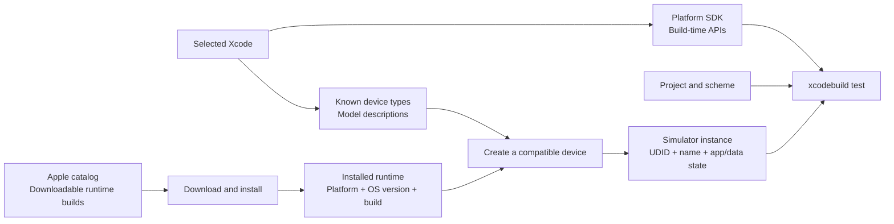
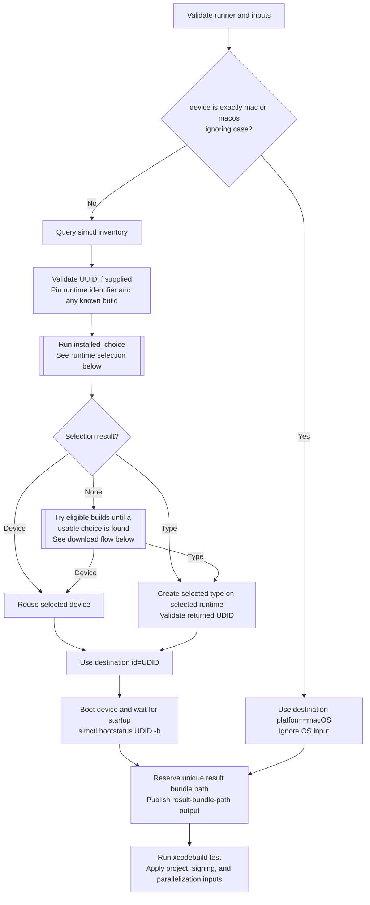
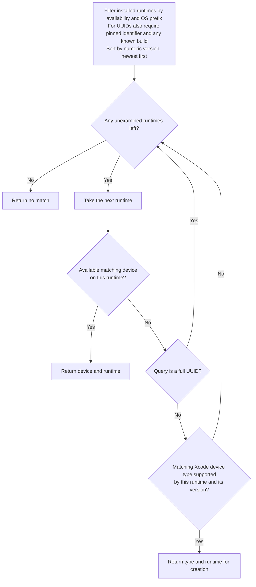
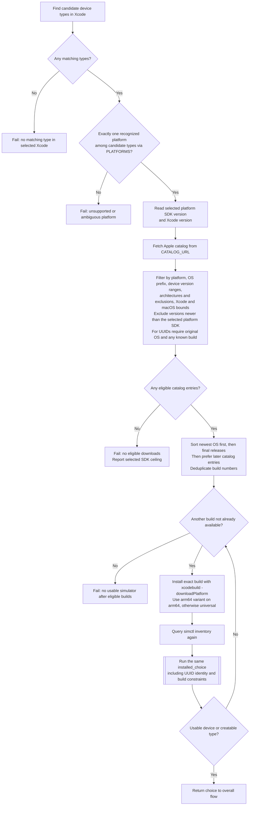

# Destination selection and testing

These charts describe [run.py](run.py) and [simulators.py](simulators.py).
The optional Swift package cache steps in [action.yml](action.yml) run before
`run.py` and do not change simulator selection. Any failed external command
stops the action; these error edges are omitted from the charts for readability.

## Concepts and relationships

A simulated device combines a **device type** with a **runtime** and its own
identity and data. The type describes the model; the runtime supplies the OS;
the created device is the instance on which tests run. Many devices can share
one runtime, and the same device type can be used with several compatible OS
versions. Installing a runtime and creating a device are separate operations.
See Apple's [explanation of simulator runtimes and devices](https://developer.apple.com/documentation/safari-developer-tools/adding-additional-simulators).

| Entity | Role and identity |
| --- | --- |
| Host Mac | Runs Xcode and CoreSimulator. Its macOS version and architecture constrain which runtimes can run. The host OS is separate from the simulated OS. |
| Selected Xcode | Provides the build tools and platform SDKs. `DEVELOPER_DIR` or `xcode-select` chooses the installation used by `xcrun` and `xcodebuild`. A runtime does not replace Xcode or add an unknown device type to its inventory. |
| Platform / product family | The OS family, such as iOS or watchOS, and the device family, such as iPhone or Apple Watch. Several device families can share one platform: iPhone and iPad both map to the iOS simulator platform. |
| SDK | Platform APIs and build definitions used to compile the app. Its version is distinct from the OS version on which the compiled app runs. This action also uses the selected platform SDK version as a conservative download ceiling. |
| OS version | A release label such as `27.2`. The `os` input filters these labels by prefix. A version alone does not identify a unique runtime build or establish compatibility. |
| Runtime / runtime build | The simulator OS package, installed locally from a downloadable artifact. It has a runtime identifier, an OS version, and a build number. Different builds of the same OS version can support different models. |
| Device type | A model description such as iPhone 17, with a stable type identifier such as `com.apple.CoreSimulator.SimDeviceType.iPhone-17`. It records the product family and supported OS version range. Types can exist without any installed runtimes or created devices. |
| Device / simulator instance | A created virtual device with a name, a unique UDID, a device type, a runtime association, and its own app/data state. Its display name can change; the UDID identifies the instance. Several instances can have the same model and name. |
| Scheme / test destination | The scheme specifies what Xcode builds and tests. A destination specifies where to run it: this action uses a simulator UDID or `platform=macOS`. The scheme must support that destination. |



For example, two catalog entries may both say **iOS 27.2**, while one build
supports general iPhone/iPad models and another supports iPhone Duo. Their
installed runtime identifiers can also differ, such as `iOS-27-2` versus
`iOS-27-2-iPhone19-4`. The action therefore retains build and runtime identity
instead of treating the OS version as a complete identity.

"Simulator" can refer broadly to the simulation tools or to one simulated
device. Here, selection means choosing a device instance and its runtime.
CoreSimulator manages these resources; `simctl` is the command-line interface
used by the action. A graphical simulator window is not required.

## Compatibility has several layers

Matching an input is a selection rule, not proof of compatibility. For example,
`os: '27'` accepts any version string beginning with `27`, but each candidate
still needs to pass the relevant checks below.

| Relationship | What determines compatibility | How this action checks it |
| --- | --- | --- |
| Host / Xcode / runtime | Host OS, architecture, installed tools, and runtime requirements. | Applies catalog Xcode/macOS bounds and architecture rules when present, then requires `simctl` runtime availability after installation. Missing catalog bounds do not prove support. |
| SDK / download candidate | The action limits downloads to OS versions no newer than the selected platform SDK. | Reads the SDK version and compares numeric versions. This is a conservative action policy, not a universal Apple rule or a guarantee of compatibility. Already installed runtimes are not subject to this ceiling. |
| Device type / runtime | The runtime must support the model, and its OS must be within the type's version range. | Before creation, requires the type in the runtime's `supportedDeviceTypes` and checks the type's minimum/maximum OS versions. Catalog filtering knows the version range but may lack model support, so it can require trying multiple builds. |
| Existing device / runtime | The device and its associated runtime must both be available. | Requires `isAvailable: true` on both. For an exact UDID, also retains the original runtime identifier and any known build. |
| Device / execution | An available device may still be shut down. Booting and app launch can fail independently. | Runs `simctl bootstatus <udid> -b` and waits before testing. Availability does not mean the device is already booted or guarantee an app will launch successfully. |
| Project / destination | The scheme's platform, app deployment target, build architecture, and test configuration must support the destination. | Leaves project-specific validation to `xcodebuild test`. The simulator selector does not inspect the scheme; a bootable simulator can still be an invalid destination for that project. |

For example, an app whose minimum OS is 27 cannot run on an OS 26 simulator even
if that simulator is healthy. A watchOS scheme likewise needs a suitable watchOS
destination. Apple describes this relationship in
[selecting a scheme and run destination](https://developer.apple.com/documentation/xcode/running-your-app-on-simulated-or-physical-devices).

For `device: mac` or `macos`, tests run natively on the host Mac. There is no
simulator runtime or simulator UDID, and `os` is ignored. The scheme must still
support native macOS testing.

## Where the information comes from

The local inventory answers **what this machine knows about and can use**. The
catalog answers **which runtime builds Apple lists for downloading**. Neither
alone tells us whether the requested project's tests will run successfully.

### Local machine

The action reads all three simulator collections in one command:

```sh
xcrun simctl list --json
```

| JSON collection | Relevant fields and relationships |
| --- | --- |
| `devicetypes` | `identifier`, `name`, `productFamily`, `minRuntimeVersionString`, and `maxRuntimeVersionString`. These describe known models independently of created devices. |
| `runtimes` | `identifier`, `version`, `buildversion`, `isAvailable`, and `supportedDeviceTypes`. The supported type identifiers link back to `devicetypes`. |
| `devices` | A dictionary keyed by runtime identifier. Each device records its `udid`, `name`, `deviceTypeIdentifier`, and `isAvailable`. Device records may remain after their runtime is removed. |

The action also runs `xcodebuild -version` and
`xcrun --sdk <platform> --show-sdk-version` when preparing a download. For iOS,
the SDK argument is `iphoneos`; the other values come from `PLATFORMS`.
Python's `platform.mac_ver()` and `platform.machine()` supply host version and
architecture information. `xcrun simctl create` creates a device from a type
identifier and runtime identifier and returns its UDID.

### Apple's simulator catalog

`CATALOG_URL` points to
[Apple's downloadable simulator index](https://devimages-cdn.apple.com/downloads/xcode/simulators/index2.dvtdownloadableindex).
The action fetches it with `curl` and parses the plist using Python's `plistlib`.
It reads the `downloadables` collection; it does not query Apple for local
device instances or UDIDs.

| Catalog field | How it is used |
| --- | --- |
| `platform` | Filters the OS family, for example `com.apple.platform.iphoneos`. `PLATFORMS` maps the local type's `productFamily` to this suffix and the corresponding `xcodebuild -downloadPlatform` argument. |
| `simulatorVersion.version` | The OS version used for prefix filtering, numeric ordering, and the SDK ceiling. |
| `simulatorVersion.buildUpdate` | The exact runtime build passed to `-buildVersion`. Distinct builds at the same OS version remain separate candidates. |
| `architectures` | Filters the permitted architectures when listed. |
| `hostRequirements` | Optional minimum/maximum Xcode and macOS versions, plus `excludedHostArchitectures`. The action honors these constraints when present. |
| `name` | Used in logs and to distinguish final releases from beta/RC entries at the same OS version. |

The catalog can omit compatibility fields and does not reliably identify the
models supported by each build. The action therefore treats a catalog match as
an eligible download, installs it using `xcodebuild -downloadPlatform`, and
queries the local inventory again. It proceeds only when the installed result
provides a usable matching device or a supported type that can be created.
The following flowcharts show that process and its failure paths.

## Overall flow

`installed_choice` returns an existing device, a type that can be created on a
specific runtime, or no match. The same selection procedure runs before and
after a download. A UUID query can only return its existing device or no match;
it never produces a replacement device.



Input validation rejects an unsupported host, empty device or scheme, invalid
simulator OS prefix, invalid project path, and invalid signing/parallelization
toggles. A failed device creation, invalid returned UDID, or boot failure stops
before the result bundle path is published. The path is published before
testing, but Xcode may fail before creating the bundle.

## Installed runtime selection

The loop examines only installed, available runtimes matching the literal OS
prefix. An empty prefix permits all versions. Numeric ordering puts 27.10 above
27.2. When there are no eligible runtimes, the loop immediately returns no match.



An existing device wins over creation on the same runtime. A creatable type on
a newer runtime wins over an existing device on an older runtime. This rule also
applies after downloading; the action does not search all runtimes for existing
devices first.

Device names match by case-insensitive prefix; full UDIDs and device type
identifiers match exactly. Candidate types include types whose names or
identifiers match, plus the types of matching renamed or unavailable devices.
Devices are ordered by name then UDID, and types by name then identifier.
Runtime identifiers break ties between equal numeric versions, in descending
order. Creation requires both membership in the runtime's `supportedDeviceTypes`
and an OS version within the type's minimum/maximum range.

## UUID validation

UUID validation runs before installed runtime selection. It locates the exact
existing device and rejects an unknown UUID or a mismatch between its OS and the
requested prefix. It pins the original runtime identifier and any known build.
If the runtime record is missing, it extracts the numeric OS version from the
identifier while preserving a model suffix such as `-iPhone19-4`. An identifier
whose version cannot be recovered fails with a diagnostic.

An available runtime paired with an unavailable device fails immediately.
If the runtime is missing or unavailable, downloads must restore the same
runtime identifier and any known build. The same UUID must become available;
the action never creates a replacement device. When the build is unknown, it
can try multiple builds of the original OS version.

## Download flow

This path runs only when installed runtime selection returns no match. The
catalog supplies OS runtimes; device types must already be known to the selected
Xcode. Platform validation now happens before any catalog request.



The catalog compatibility check requires the OS version to fit at least one
candidate type's version range. Catalog entries often omit Xcode/macOS bounds
and device model support, so this check is not proof of compatibility. The
selected platform SDK provides a conservative upper limit for downloads: an
Xcode with the iOS 17 SDK cannot select an iOS 27 download merely because catalog
bounds are absent. Installed runtime selection is not restricted by this ceiling.

After each successful installation, `simctl` must confirm that the runtime is
available and a matching device is usable or can be created. Different models
can require different builds of the same version. If one build provides no match,
the action tries remaining eligible builds, each at most once. Already available
builds have been rejected by installed selection and are skipped. A download
command failure stops immediately; it is not swallowed to try another build.
All installed runtimes remain on the runner, so fallback attempts can use
additional time and disk space.

Final releases beat prereleases only at the same OS version. A newer beta can
win over an older final release if it is within the SDK limit. This action does
not inspect the scheme's platform or deployment target when selecting a
simulator; `xcodebuild test` reports project-specific destination mismatches.

`PLATFORMS` maps each recognized `productFamily` to the download command's
platform name and the catalog platform suffix. It is only consulted on the
download path. Unknown product families contribute no platform; zero or multiple
distinct recognized platforms cause an error before fetching the catalog.

| Query with no installed devices or runtimes | Result, assuming Xcode knows the listed types |
| --- | --- |
| `iP` | iPad, iPhone, and iPod touch all map to `("iOS", "iphoneos")`. Try eligible iOS builds until a matching device can be reused or created. Creation chooses the first supported type in name order. |
| `Apple` | Apple TV, Apple Watch, and Apple Vision map to different platforms. Fail on platform ambiguity before fetching the catalog or downloading a runtime. |
| `iPhone Duo`, OS `27.2` | With a suitable SDK, a general iOS 27.2 build may install but provide no matching type. Continue to the model-specific build and create the device there. |

An ambiguous query may still succeed using installed runtimes, because the
single-platform requirement is enforced only when selecting a download.
