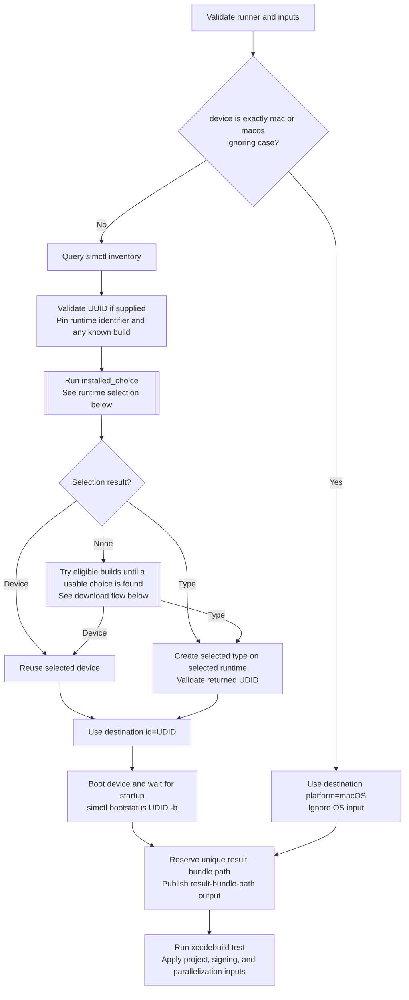
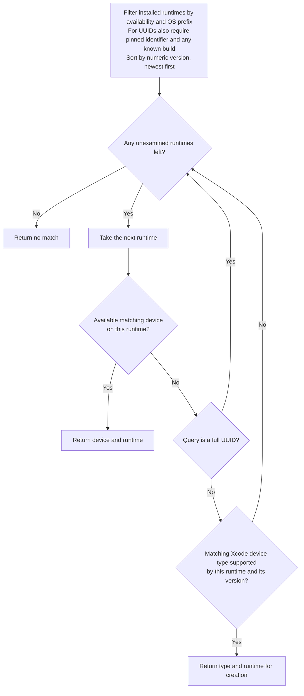
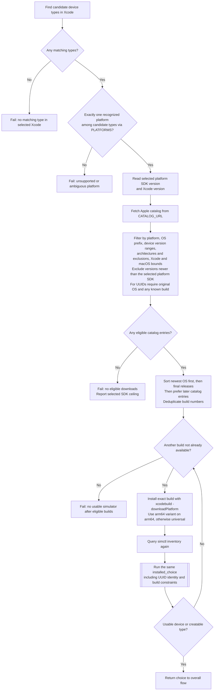

# Destination selection and testing

These charts describe [run.py](run.py) and [simulators.py](simulators.py).
The optional Swift package cache steps in [action.yml](action.yml) run before
`run.py` and do not change simulator selection. Any failed external command
stops the action; these error edges are omitted from the charts for readability.

| Term | Meaning in this action |
| --- | --- |
| Runtime | A simulator OS installation, such as iOS 27.2. It is usable when `simctl` reports `isAvailable: true`. |
| Device type | A hardware model known to the selected Xcode, such as iPhone 17. Types can exist without installed runtimes or created devices. |
| Device | A created simulator instance with a UDID, associated with one runtime. It must also report `isAvailable: true` to be reused. |

## Overall flow

`installed_choice` returns an existing device, a type that can be created on a
specific runtime, or no match. The same selection procedure runs before and
after a download. A UUID query can only return its existing device or no match;
it never produces a replacement device.

Input validation rejects an unsupported host, empty device or scheme, invalid
simulator OS prefix, invalid project path, and invalid signing/parallelization
toggles. A failed device creation, invalid returned UDID, or boot failure stops
before the result bundle path is published. The path is published before
testing, but Xcode may fail before creating the bundle.

## Installed runtime selection

The loop examines only installed, available runtimes matching the literal OS
prefix. An empty prefix permits all versions. Numeric ordering puts 27.10 above
27.2. When there are no eligible runtimes, the loop immediately returns no match.

An existing device wins over creation on the same runtime. A creatable type on
a newer runtime wins over an existing device on an older runtime. This rule also
applies after downloading; the action does not search all runtimes for existing
devices first.

Device names match by case-insensitive prefix; full UDIDs and device type
identifiers match exactly. Candidate types include types whose names or
identifiers match, plus the types of matching renamed or unavailable devices.
Devices are ordered by name then UDID, and types by name then identifier.
Runtime identifiers break ties between equal numeric versions, in descending
order. Creation requires both membership in the runtime's `supportedDeviceTypes`
and an OS version within the type's minimum/maximum range.

## UUID validation

UUID validation runs before installed runtime selection. It locates the exact
existing device and rejects an unknown UUID or a mismatch between its OS and the
requested prefix. It pins the original runtime identifier and any known build.
If the runtime record is missing, it extracts the numeric OS version from the
identifier while preserving a model suffix such as `-iPhone19-4`. An identifier
whose version cannot be recovered fails with a diagnostic.

An available runtime paired with an unavailable device fails immediately.
If the runtime is missing or unavailable, downloads must restore the same
runtime identifier and any known build. The same UUID must become available;
the action never creates a replacement device. When the build is unknown, it
can try multiple builds of the original OS version.

## Download flow

This path runs only when installed runtime selection returns no match. The
catalog supplies OS runtimes; device types must already be known to the selected
Xcode. Platform validation now happens before any catalog request.

The catalog compatibility check requires the OS version to fit at least one
candidate type's version range. Catalog entries often omit Xcode/macOS bounds
and device model support, so this check is not proof of compatibility. The
selected platform SDK provides a conservative upper limit for downloads: an
Xcode with the iOS 17 SDK cannot select an iOS 27 download merely because catalog
bounds are absent. Installed runtime selection is not restricted by this ceiling.

After each successful installation, `simctl` must confirm that the runtime is
available and a matching device is usable or can be created. Different models
can require different builds of the same version. If one build provides no match,
the action tries remaining eligible builds, each at most once. Already available
builds have been rejected by installed selection and are skipped. A download
command failure stops immediately; it is not swallowed to try another build.
All installed runtimes remain on the runner, so fallback attempts can use
additional time and disk space.

Final releases beat prereleases only at the same OS version. A newer beta can
win over an older final release if it is within the SDK limit. This action does
not inspect the scheme's platform or deployment target when selecting a
simulator; `xcodebuild test` reports project-specific destination mismatches.

`PLATFORMS` maps each recognized `productFamily` to the download command's
platform name and the catalog platform suffix. It is only consulted on the
download path. Unknown product families contribute no platform; zero or multiple
distinct recognized platforms cause an error before fetching the catalog.

| Query with no installed devices or runtimes | Result, assuming Xcode knows the listed types |
| --- | --- |
| `iP` | iPad, iPhone, and iPod touch all map to `("iOS", "iphoneos")`. Try eligible iOS builds until a matching device can be reused or created. Creation chooses the first supported type in name order. |
| `Apple` | Apple TV, Apple Watch, and Apple Vision map to different platforms. Fail on platform ambiguity before fetching the catalog or downloading a runtime. |
| `iPhone Duo`, OS `27.2` | With a suitable SDK, a general iOS 27.2 build may install but provide no matching type. Continue to the model-specific build and create the device there. |

An ambiguous query may still succeed using installed runtimes, because the
single-platform requirement is enforced only when selecting a download.
