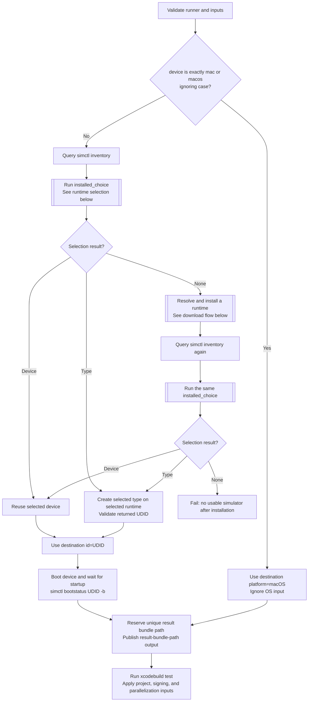
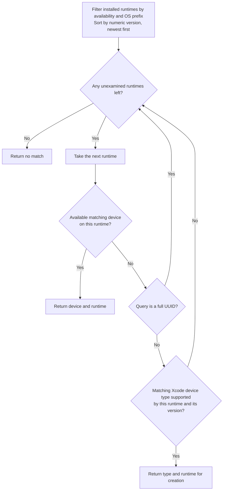
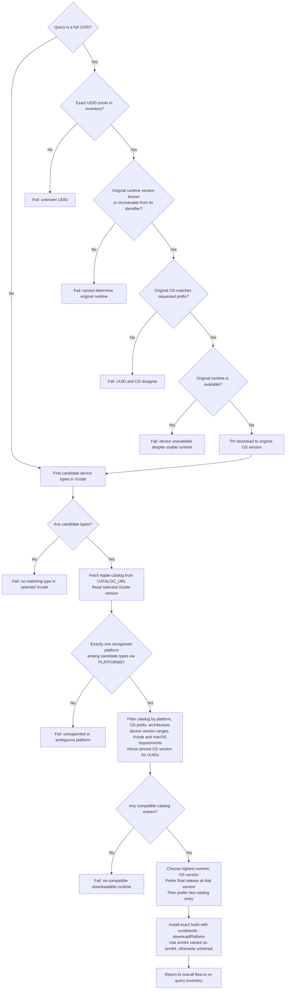

# Destination selection and testing

These charts describe [run.py](run.py) and [simulators.py](simulators.py).
The optional Swift package cache steps in [action.yml](action.yml) run before
`run.py` and do not change simulator selection. Any failed external command
stops the action; these error edges are omitted from the charts for readability.

| Term | Meaning in this action |
| --- | --- |
| Runtime | A simulator OS installation, such as iOS 27.2. It is usable when `simctl` reports `isAvailable: true`. |
| Device type | A hardware model known to the selected Xcode, such as iPhone 17. Types can exist without installed runtimes or created devices. |
| Device | A created simulator instance with a UDID, associated with one runtime. It must also report `isAvailable: true` to be reused. |

## Overall flow

`installed_choice` returns an existing device, a type that can be created on a
specific runtime, or no match. The same selection procedure runs before and
after a download. A UUID query can only return its existing device or no match;
it never produces a replacement device.

Input validation rejects an unsupported host, empty device or scheme, invalid
simulator OS prefix, invalid project path, and invalid signing/parallelization
toggles. A failed device creation, invalid returned UDID, or boot failure stops
before the result bundle path is published. The path is published before
testing, but Xcode may fail before creating the bundle.

## Installed runtime selection

The loop examines only installed, available runtimes matching the literal OS
prefix. An empty prefix permits all versions. Numeric ordering puts 27.10 above
27.2. When there are no eligible runtimes, the loop immediately returns no match.

An existing device wins over creation on the same runtime. A creatable type on
a newer runtime wins over an existing device on an older runtime. This rule also
applies after downloading; the action does not search all runtimes for existing
devices first.

Device names match by case-insensitive prefix; full UDIDs and device type
identifiers match exactly. Candidate types include types whose names or
identifiers match, plus the types of matching renamed or unavailable devices.
Devices are ordered by name then UDID, and types by name then identifier.
Runtime identifiers break ties between equal numeric versions, in descending
order. Creation requires both membership in the runtime's `supportedDeviceTypes`
and an OS version within the type's minimum/maximum range.

## Download flow

This path runs only when installed runtime selection returns no match. The
catalog supplies OS runtimes; device types must already be known to the selected
Xcode. Fetching the catalog and reading the Xcode version happen before the
platform ambiguity check in the current implementation.

The catalog compatibility check requires the OS version to fit at least one
candidate type's version range. Runtime support for a particular type is checked
against `simctl` again after installation. A successful download therefore does
not guarantee a usable destination; the action fails if the second selection
still finds none. It does not retry with another catalog entry.

`PLATFORMS` maps each recognized `productFamily` to the download command's
platform name and the catalog platform suffix. It is only consulted on the
download path. Unknown product families contribute no platform; zero or multiple
distinct recognized platforms cause an error.

| Query with no installed devices or runtimes | Result, assuming Xcode knows the listed types |
| --- | --- |
| `iP` | iPad, iPhone, and iPod touch all map to `("iOS", "iphoneos")`. The action can download a compatible iOS runtime, then reuse or create a matching device. Creation chooses the first supported type in name order. |
| `Apple` | Apple TV, Apple Watch, and Apple Vision map to different platforms. The action fetches the catalog, then fails on platform ambiguity without downloading a runtime. |

An ambiguous query may still succeed using installed runtimes, because the
single-platform requirement is enforced only when selecting a download.
